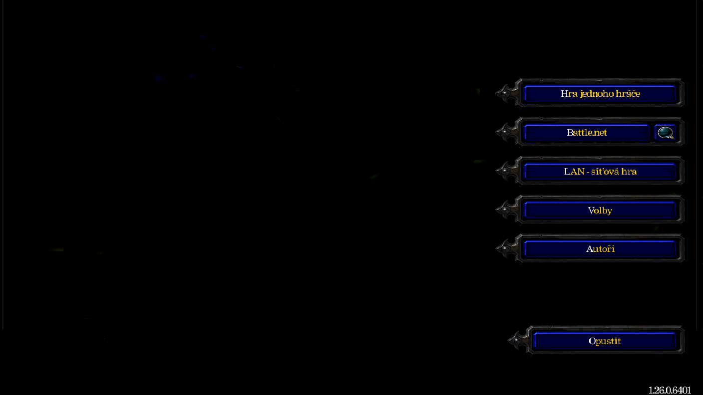

# Warcraft III: The Frozen Throne in the browser

**English** · [Česky](#česky)

A fan project that runs the PC game *Warcraft III: The Frozen Throne* (patch 1.26a, 32-bit) in Google Chrome.
The game's x86 code is translated to C ahead of time and compiled to WebAssembly. Win32, Direct3D 8, sound and
Winsock are reimplemented, the graphics run on WebGPU, and LAN play between browsers goes through the project's own
server. You bring your own copy of the game.

<!-- Live version: add the public address of your server here, e.g. **Play:** https://wc3.example.cz -->



> Not affiliated with or endorsed by Blizzard Entertainment. This repository contains none of the game's code or
> data: no EXE, DLL or MPQ, no C translated from them, no compiled module (`.gitignore` keeps them out).

## Status

| Part | State |
|---|---|
| Translation and build of all 8 game modules | works |
| Win32, Direct3D 8 on WebGPU, game threads in the browser | works |
| Main menu in Chrome | works (screenshot above) |
| Start page: browser check, loading ring, controls | works (`web/landing.html`) |
| Skirmish, sound (Miles), LAN for several players, videos | in progress |
| Touch controls | not planned |

The plan, the state and the measured numbers are in [docs/PLAN.md](docs/PLAN.md) (in Czech).

## What you need

- **The game:** Warcraft III + The Frozen Throne patched to **1.26a** (`war3.exe` / `Game.dll` 1.26.0.6401). The exact
  files and their SHA-256 are in [docs/PLAN.md](docs/PLAN.md#vstupní-soubory-126a); other versions will not work.
- **To play:** a current Chrome or Edge with WebGPU, and a page served over HTTPS (or `localhost`): WebGPU and threads
  (SharedArrayBuffer) need a secure page.
- **To build:** Linux or WSL 2 (clone in the Linux file system, e.g. `~/wc3-web`), Python 3 with `pefile` and
  `capstone` 5, Node.js 20+, Rust and wasi-sdk.

## Run it

```sh
./gen.sh "/path/to/Warcraft III"                                   # lift the game's code to C (gen/, never committed)
./build.sh                                                         # compile and link -> out/web/wc3.wasm
node web/build.mjs                                                 # the page's scripts
node web/tools/wc3-dev-server.mjs --data "/path/to/Warcraft III"   # http://localhost:8086/
```

Open **http://localhost:8086/**. The start page checks the browser (secure page, threads, WebGPU, storage), shows the
module's version on the server, lets you pick a name and the picture's resolution, shows a loading ring while the
module downloads, and lists the controls. Profiles and saves stay in the browser.

For players on other computers, run the server behind HTTPS. A QNAP / Docker Compose setup with a Cloudflare Tunnel is
in [deploy/qnap/README.md](deploy/qnap/README.md) (in Czech).

## Layout

- **`tools/`:** the x86 → C lifter (Python, Capstone) and its analyses; `tools/survey/` the phase 0 survey.
- **`runtime/`:** Windows, Direct3D, DirectSound and Winsock reimplemented; `runtime/web/` the browser parts.
- **`web/landing.html`:** the start page, one self-contained file (the server sends COEP `require-corp`, so it loads nothing from outside).
- **`web/src/`:** the page's host: game threads as workers on one shared memory, WebGPU, AudioWorklet, the LAN link.
- **`web/server-rs/`:** the server, in Rust: serves the page, the module and the game folder, and is the virtual LAN.
- **`web/deploy/`:** Docker Compose, Caddy and Cloudflare Tunnel examples.

## Origin

The method, the lifter, the Win32/D3D9/sound runtime, the WebGPU and AudioWorklet host and the Rust server come from
[nfsu2-web](https://github.com/Chuck3CZ/nfsu2-web) (MIT), the browser port of *Need for Speed: Underground 2*
(playable at [nfsu2.xyz](https://nfsu2.xyz)), which itself is based on Talha Müderrisoğlu's static recompilation of
NFSU2 and follows the method of [N64: Recompiled](https://github.com/N64Recomp/N64Recomp) and
[XenonRecomp](https://github.com/hedge-dev/XenonRecomp). The same method runs
[Colin McRae Rally 2005](https://github.com/Chuck3CZ/cmr05-web) in the browser. Built with the help of Claude Code.

## License

MIT ([LICENSE](LICENSE)). *Warcraft* and *Warcraft III: The Frozen Throne* are trademarks of Blizzard Entertainment, Inc.

---

## Česky

Fanouškovský projekt, který spouští PC hru *Warcraft III: The Frozen Throne* (patch 1.26a, 32bitová) přímo v Google
Chrome. Kód hry (x86) se předem přeloží do C a zkompiluje do WebAssembly, Win32, Direct3D 8, zvuk a Winsock jsou
napsané znovu, grafika běží na WebGPU a síťovou hru (LAN) mezi prohlížeči zprostředkuje vlastní server projektu.
Vlastní kopii hry si přineseš sám.

**Stav:** hlavní menu běží v Chrome. Skirmish, zvuk, LAN pro více hráčů a videa se dělají. Podrobný plán, stav a
naměřená čísla jsou v [docs/PLAN.md](docs/PLAN.md).

**Co potřebuješ:** hru Warcraft III + The Frozen Throne ve verzi **1.26a** (jiné verze nepůjdou), k hraní aktuální
Chrome nebo Edge s WebGPU a stránku přes HTTPS (nebo `localhost`). K sestavení Linux nebo WSL 2, Python 3 s `pefile`
a `capstone` 5, Node.js 20+, Rust a wasi-sdk.

**Spuštění:** příkazy jsou v části *Run it* výše; stránka pak běží na `http://localhost:8086/`. Nasazení na QNAP
s Cloudflare Tunnelem je v [deploy/qnap/README.md](deploy/qnap/README.md).

**Startovní stránka** (`web/landing.html`) před spuštěním zkontroluje prohlížeč, ukáže verzi modulu na serveru, nechá
zvolit jméno a rozlišení, při stahování modulu ukazuje načítací kroužek a obsahuje přehled ovládání. Je to jediný
soubor bez závislostí, protože server posílá COEP `require-corp` a stránka nesmí nic načítat zvenčí.

> Projekt nijak nesouvisí s Blizzard Entertainment a není jí schválen. Repozitář neobsahuje žádný kód ani data hry.
